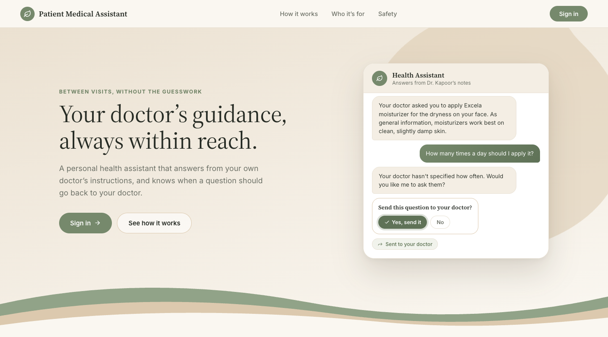
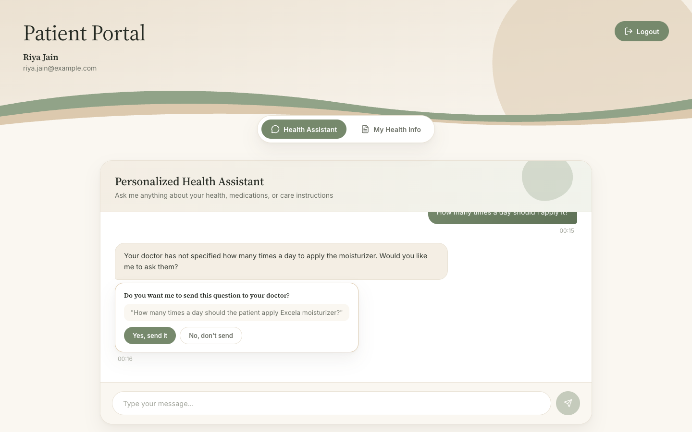
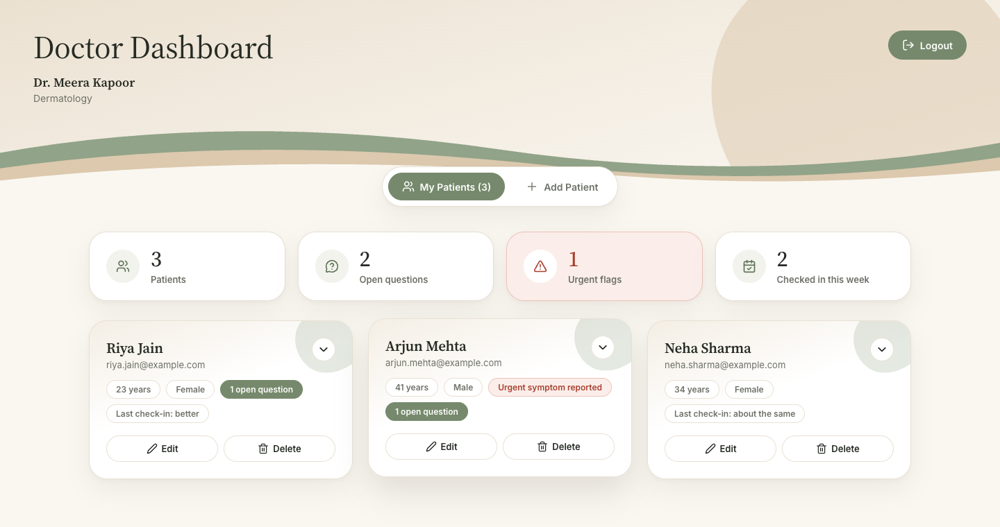
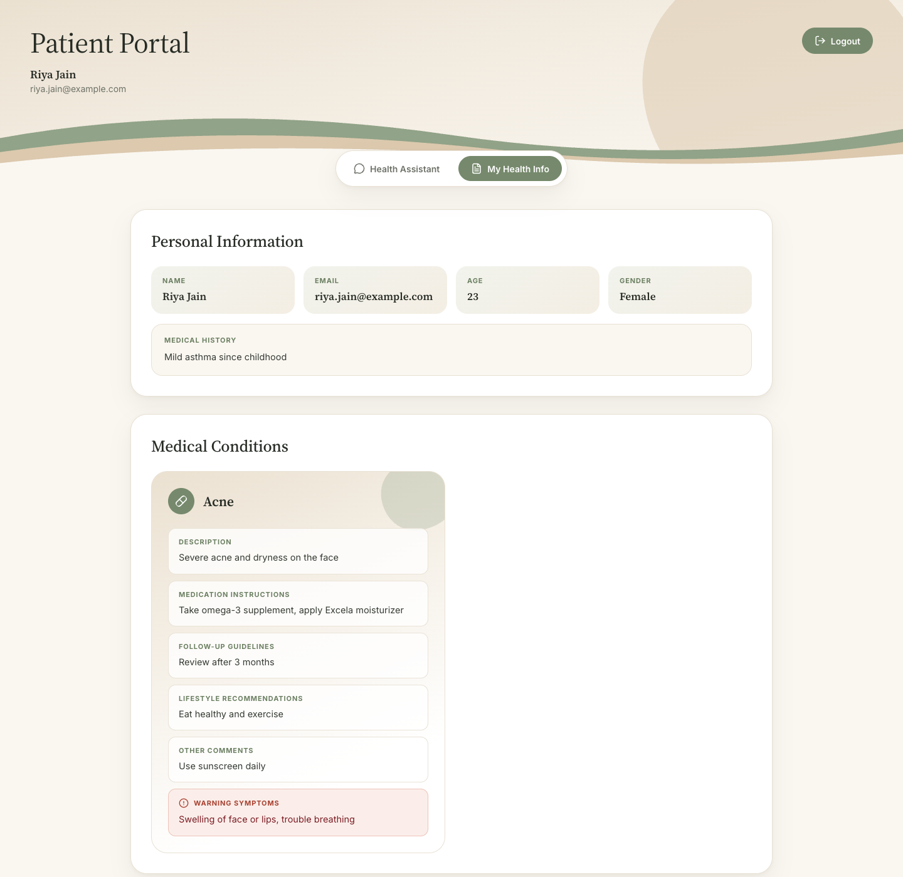
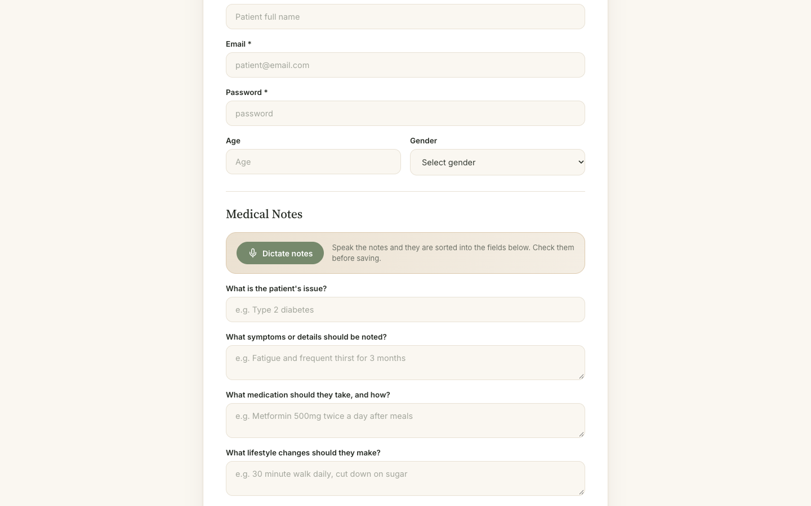
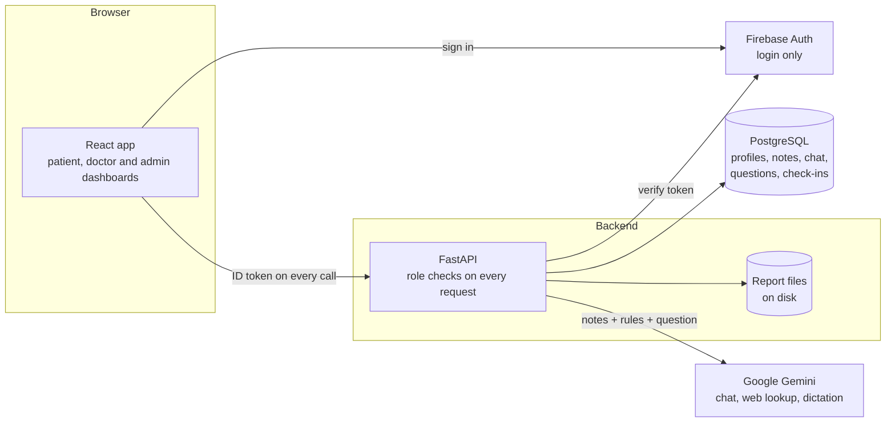

# Patient Medical Assistant

A follow-up channel between a doctor and their patients. The doctor writes (or dictates) a care plan; the patient gets an AI assistant that answers questions **from that doctor's own instructions**, hands anything it shouldn't answer back to the doctor, and raises a flag when the patient describes an emergency.

It is not a general medical chatbot. A general chatbot answers from textbook knowledge about an average patient. This one answers from what one specific doctor decided for one specific patient, and it is built to know when to stop.



> **Demonstration project.** It does not provide medical advice and is not a substitute for a doctor.

## What it does

**For patients**
- Ask the assistant about their condition, medicines, lifestyle advice and follow-up, at any time.
- Get plain-language explanations and clearly labelled general health information.
- Choose whether a question the assistant can't answer is sent to their doctor, and see the doctor's reply.
- Send a weekly check-in (better / same / worse) and view their conditions and reports.

**For doctors**
- Add patients and write their care plan through guided questions, or **dictate it by voice** and have it sorted into the right fields.
- See open questions, urgent flags and check-in history for every patient, and reply once for both the patient and the assistant.
- Edit notes, upload, rename and delete reports.

**For clinic admins**
- Create and remove doctor accounts, and reassign patients whose doctor has left.
- No access to medical notes or chats.

Nobody signs themselves up: admins create doctors, and doctors create patients.

| Patient chat | Doctor dashboard |
|---|---|
|  |  |

| Patient health info | Voice dictation of notes |
|---|---|
|  |  |

## How the assistant is kept safe

The assistant is restricted on purpose. On every message the backend loads that patient's notes from the database and sends them to the model along with a fixed set of rules:

- **It answers from the doctor's notes** and the doctor's earlier replies, and may add general, widely accepted health information, labelled as general.
- **It never changes treatment.** It will not start, stop, pause or adjust a medicine or dose, and will not invent a dose or frequency the doctor didn't write.
- **It asks before it shares.** When a question needs the doctor, it offers to send it, and nothing is sent until the patient says yes.
- **It flags emergencies.** If the patient describes a warning symptom the doctor listed, or something that sounds like an emergency, it tells them to get help now and the doctor sees an urgent flag.
- **It can look a named product up online** and cites the pages it used. Only the product name is sent to the search, never patient details.

The model returns a structured reply (`reply`, `urgent`, `question_for_doctor`), so the backend acts on fields, not on parsing free text.

These rules are instructions to a language model, not hard guarantees, which is why the project measures them.


## Architecture



- **Firebase is used for login only.** The browser signs in with Firebase and sends the resulting ID token with every request. The backend verifies the token and looks up the user's role in PostgreSQL.
- **All application data lives in PostgreSQL**: admins, doctors, patients, conditions, reports, chat messages, questions for the doctor and check-ins.
- **Access is enforced on the server.** A patient can reach only their own data, a doctor only their own patients, and an admin only account management.
- **Report files** are stored on the backend's disk and served only to the patient or their doctor.
- **Redis** caches online product lookups for a week (shared by all patients, since they contain nothing personal) and rate-limits the endpoints that call Gemini, per user. The assistant's answers are deliberately **not** cached: they depend on each patient's notes, and a stale answer about a medicine would be unsafe. If Redis is not running, the app carries on without the cache or the limits.

### Tech stack

| Layer | Technology |
|---|---|
| Frontend | React 19, React Router, Axios, CSS modules |
| Backend | Python, FastAPI, SQLAlchemy, Pydantic |
| Database | PostgreSQL |
| Authentication | Firebase Authentication (email and password) |
| Cache and rate limiting | Redis (optional) |
| AI | Google Gemini via `google-genai` (structured output, Google Search grounding, audio input) |

### Project layout

```
backend/
  main.py                 API endpoints
  auth.py                 token verification and role checks
  models.py, schemas.py   database tables and request/response shapes
  gemini_client.py        chat, web lookup and voice dictation
  cache.py                Redis cache and per-user rate limiter
  prompConfig.py          the assistant's rules
  create_admin.py         creates an admin account
  evals/                  evaluation suite, cases and results
src/
  components/Landing      front page
  components/Auth         login
  components/Patient      patient portal and chat
  components/Doctor       doctor dashboard, patient details, voice dictation
  components/Admin        admin dashboard
  lib/api.js              every call to the backend
  index.css               design tokens (colours, fonts, shapes)
```

## Running it locally

### You will need

- Node.js 18 or newer and Python 3.11 or newer (developed on Node 20 and Python 3.13)
- PostgreSQL 14 or newer
- A Firebase project with **Email/Password** sign-in enabled, and a service account key for it
- A Google Gemini API key
- Redis (optional, for caching and rate limiting): `brew install redis && brew services start redis`

### 1. Backend

```bash
python3 -m venv venv
venv/bin/pip install -r backend/requirements.txt

createdb patient_assistant
cp backend/.env.example backend/.env    # then fill in your values
```

Download a service account key from the Firebase console (Project settings → Service accounts → Generate new private key), save it as `backend/serviceAccountKey.json`, and set `FIREBASE_CREDENTIALS` in `backend/.env` to its absolute path. That file and `backend/.env` are git-ignored; never commit them.

```bash
venv/bin/python backend/run_server.py
```

The API runs at http://localhost:8000 (interactive docs at `/docs`). Tables are created on first start.

### 2. Create an admin

Admins are the only accounts not created inside the app:

```bash
venv/bin/python backend/create_admin.py admin@example.com "a-strong-password" "Admin Name"
```

### 3. Frontend

Put your Firebase project's web config in `src/firebaseConfig.js`, then:

```bash
npm install
npm start
```

The app opens at http://localhost:3000. Sign in as the admin, add a doctor, sign in as that doctor and add a patient.

### Running the evaluation suite

```bash
venv/bin/python backend/evals/run_evals.py                      # all cases
venv/bin/python backend/evals/run_evals.py --category emergency # one category
venv/bin/python backend/evals/run_evals.py --resume             # continue an interrupted run
venv/bin/python backend/evals/run_evals.py --validate-judge     # check the judge model
```

## Limitations

- **The safety rules are prompts, not hard blocks.** The evaluation above measures how well they hold; it does not prove they always will. Emergency detection depends on the model, so it must not be the only safety net.
- **Patient data is sent to Google Gemini** for chat, dictation and product lookup. A real deployment would need consent, a data processing agreement and probably a different hosting arrangement.
- **Doctors are not notified.** Urgent flags and questions appear when the doctor opens the dashboard; there is no email or push alert.
- **No password reset or change.** Doctors and patients keep the password they were given.
- **Doctor identity is not verified.** An admin vouches for each doctor; the license number is not checked against a register.
- **Uploaded reports are stored but not read** by the assistant.
- **Free-tier Gemini quotas are small.** The online lookup model in particular is limited to a handful of requests a day on the free tier.
- **Not deployed.** It runs locally; report files are stored on local disk.
